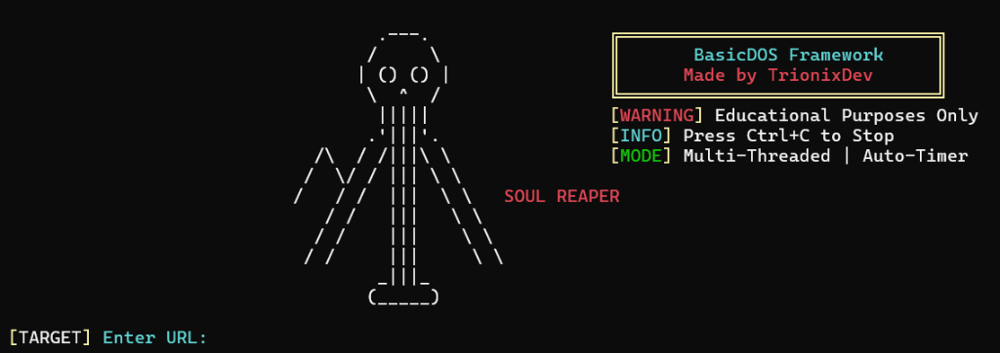

# BasicDOS




Motor assíncrono de testes de carga **HTTP/HTTPS** com suporte a **HTTP/2**, pool de ligações keep-alive (reutilização TLS), fase de warmup, painel em tempo real com **`rich`** e exportação de relatórios em **JSON** e **CSV**.

---

## Funcionalidades

- **Alta Performance em HTTPS & HTTP/2**: Utiliza `asyncio` + `httpx[http2]` com pool de ligações keep-alive e multiplexing HTTP/2, evitando handshakes TLS desnecessários.
- **Métricas Completas em Tempo Real (`rich`)**: Total de pedidos, breakdown exato por código HTTP (`status_codes`), `2xx / 3xx / 4xx / 5xx`, timeouts, falhas de ligação/TLS, volume transferido (`MB` e `MB/s`), RPS atual, latência **`min / avg / max`** e percentis **`p50 / p95 / p99`**.
- **Fase de Warmup (`--warmup`)**: Aquece as ligações TLS/HTTP2 antes de iniciar a contabilização das métricas finais.
- **Autenticação Rápida**: Suporte nativo a `--bearer <token>` e `--basic-auth <user:pass>`.
- **Assistente Interativo + Modo CLI / CI (`--quiet`)**: Corre `python main.py` para usar o menu numerado, ou usa flags com `--quiet` para integração em scripts e pipelines CI.
- **Corpo via Ficheiro (`--data-file`) & Exportação (`-o` / `--csv`)**: Carrega payloads a partir de ficheiros e guarda relatórios em JSON ou anexa linhas em CSV para comparar execuções.

---

## Instalação

```bash
# Clonar o repositório
git clone https://github.com/YannickSaiegh/BasicDOS.git
cd BasicDOS

# (Opcional) Criar e ativar ambiente virtual
python -m venv .venv
# Windows (PowerShell)
.venv\Scripts\Activate.ps1
# Linux / macOS
source .venv/bin/activate

# Instalar dependências (inclui suporte HTTP/2)
pip install -r requirements.txt
```

---

## Utilização

### 1. Modo Interativo

```bash
python main.py
```

### 2. Modo Linha de Comandos (CLI)

**Teste HTTPS com HTTP/2, 3s de warmup, 30s de medição e 150 workers:**

```bash
python main.py https://meu-servidor.local/health -c 150 --warmup 3 -d 30
```

**Teste autenticado com Bearer token, payload de ficheiro, modo silencioso e exportação CSV + JSON:**

```bash
python main.py https://api.meu-servidor.local/events \
  -m POST \
  -c 100 \
  -n 5000 \
  --max-rps 300 \
  --bearer "MEU_TOKEN" \
  -H "Content-Type: application/json" \
  --data-file payload.json \
  --quiet \
  -o load_report.json \
  --csv load_report.csv
```

### Opções Disponíveis

| Flag | Descrição | Padrão |
| :--- | :--- | :--- |
| `url` | URL alvo (se omitires esquema, usa `https://`) | *(interativo)* |
| `-m`, `--method` | Método HTTP (`GET`, `POST`, `PUT`, `DELETE`, `HEAD`) | `GET` |
| `-c`, `--concurrency` | Workers assíncronos simultâneos | `100` |
| `-n`, `--requests` | Número total de pedidos (`0` = sem limite fixo) | `0` |
| `-t`, `--timeout` | Timeout por pedido em segundos | `5.0` |
| `-d`, `--duration` | Duração máxima em segundos (`0` = até `Ctrl+C`) | `0.0` |
| `--warmup` | Duração de aquecimento em segundos antes de medir | `0.0` |
| `--max-rps` | Limite global aproximado de RPS (`0` = sem limite) | `0.0` |
| `--http2` / `--no-http2` | Ativar ou desativar HTTP/2 sobre HTTPS | `--http2` |
| `-H`, `--header` | Cabeçalho extra no formato `Chave:Valor` (repetível) | `[]` |
| `--bearer` | Token Bearer para cabeçalho `Authorization` | `None` |
| `--basic-auth` | Credenciais Basic Auth (`utilizador:password`) | `None` |
| `--data` | Corpo do pedido HTTP | `None` |
| `--data-file` | Caminho de ficheiro para carregar o corpo do pedido | `None` |
| `--follow-redirects` | Seguir redirecionamentos (`301/302/307`) | `False` |
| `--insecure` | Desativar validação SSL/TLS (apenas testes locais) | `False` |
| `-q`, `--quiet` | Modo silencioso sem painel interativo (saída JSON) | `False` |
| `-o`, `--output` | Guardar resumo final em ficheiro JSON | `None` |
| `--csv` | Guardar/anexar resumo final em ficheiro CSV | `None` |

---

## Testes

```bash
pip install pytest
pytest
```

A configuração de testes está definida em `pyproject.toml` (podes também adicionar um workflow no GitHub Actions em `.github/workflows/ci.yml` com `python -m py_compile main.py && pytest`).

---

## Aviso Legal

Este projeto destina-se **exclusivamente a fins educativos, benchmarking e testes de carga autorizados** em sistemas próprios ou com permissão explícita. O uso não autorizado contra sistemas de terceiros é ilegal.

---

## Licença

Distribuído sob a licença **MIT**. Consulte [LICENSE](LICENSE) para mais detalhes.

---

**Made by TrionixDev**
